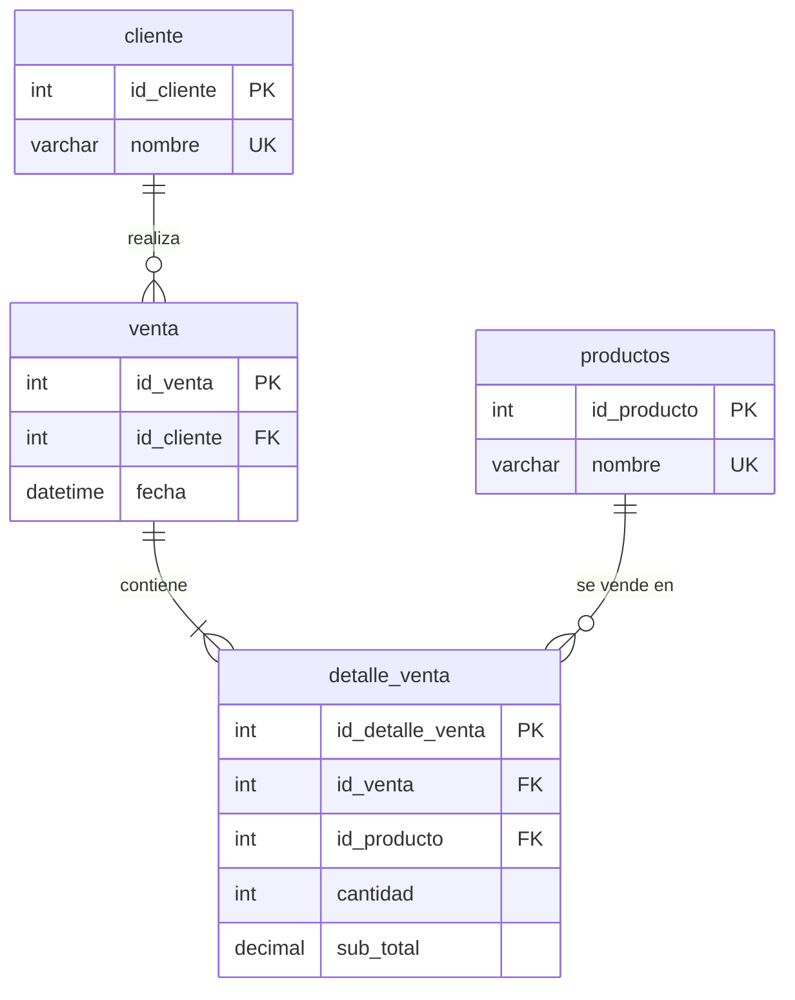

# Laboratorio de Bases de Datos 2
## Normalización y creación en SQL Server

**Curso:** Bases de Datos 2 – Ingeniería en Sistemas
**Motor:** Microsoft SQL Server
**Base de datos del ejemplo:** `BD2S22026`

---

## 1. Objetivos de aprendizaje

Al finalizar este laboratorio el estudiante será capaz de:

1. Identificar entidades, atributos y dependencias a partir de un enunciado.
2. Aplicar la **1FN, 2FN y 3FN** paso a paso, justificando cada decisión.
3. Traducir el modelo normalizado a sentencias DDL en T-SQL (`CREATE DATABASE`, `CREATE TABLE`, `PRIMARY KEY`, `FOREIGN KEY`, `UNIQUE`).
4. Verificar el diseño con datos de prueba y consultas con `JOIN`.

---

## 2. Enunciado

> Una tienda desea llevar el control de sus ventas. De cada **venta** se registra un número identificador, la **fecha y hora** en que se realizó y el **cliente** que compró (se guarda su nombre; no pueden existir dos clientes con el mismo nombre).
>
> En una misma venta el cliente puede comprar **varios productos**. De cada producto comprado se registra la **cantidad** y el **sub total** de esa línea. Cada producto tiene un identificador y un nombre (único).
>
> Un cliente puede realizar muchas ventas, y un mismo producto puede aparecer en muchas ventas.

### 2.1 Análisis del enunciado (técnica del subrayado)

| Elemento del enunciado | Se convierte en… |
|---|---|
| venta, cliente, producto | **Entidades** |
| número de venta, fecha, nombre del cliente, nombre del producto, cantidad, sub total | **Atributos** |
| "un cliente realiza muchas ventas" | Relación **1 : N** (cliente → venta) |
| "una venta incluye varios productos" y "un producto aparece en muchas ventas" | Relación **N : M** (venta ↔ producto) → requiere **tabla intermedia** |
| "no pueden existir dos clientes con el mismo nombre" | Restricción `UNIQUE` en `cliente.nombre` |

---

## 3. Punto de partida: tabla sin normalizar (UNF)

Un primer intento, tal como lo haría alguien que registra todo en una sola hoja:

```
VENTA_GENERAL (
    id_venta,
    fecha,
    nombre_cliente,
    { nombre_producto, cantidad, sub_total }   <-- grupo repetitivo
)
```

**Ejemplo de datos:**

| id_venta | fecha | nombre_cliente | productos (grupo repetitivo) |
|---|---|---|---|
| 1 | 2026-03-10 09:15 | Ana López | (Teclado, 2, 300) ; (Mouse, 1, 80) |
| 2 | 2026-03-10 11:40 | Luis Pérez | (Monitor, 1, 1500) |
| 3 | 2026-03-11 16:05 | Ana López | (Mouse, 3, 240) |

**Problemas detectados:**
- Existe un **grupo repetitivo** (varios productos dentro de una misma venta).
- Si se guarda en una sola celda, no se puede consultar ni filtrar por producto.
- El nombre del cliente se repite en cada venta de Ana López (**redundancia**).

---

## 4. Normalización paso a paso

### 4.1 Primera Forma Normal (1FN)

**Regla:** todos los atributos deben ser **atómicos** (un valor por celda) y no deben existir **grupos repetitivos**.

**Acción:** se elimina el grupo repetitivo colocando una fila por cada producto de cada venta. La llave pasa a ser **compuesta**.

```
VENTA_1FN (
    id_venta, nombre_producto,        <-- PK compuesta
    fecha, nombre_cliente, cantidad, sub_total
)
```

| id_venta | nombre_producto | fecha | nombre_cliente | cantidad | sub_total |
|---|---|---|---|---|---|
| 1 | Teclado | 2026-03-10 09:15 | Ana López | 2 | 300 |
| 1 | Mouse | 2026-03-10 09:15 | Ana López | 1 | 80 |
| 2 | Monitor | 2026-03-10 11:40 | Luis Pérez | 1 | 1500 |
| 3 | Mouse | 2026-03-11 16:05 | Ana López | 3 | 240 |

**Observación:** ahora la `fecha` y el `nombre_cliente` se repiten por cada producto de la venta 1. Esto se resuelve en 2FN.

---

### 4.2 Segunda Forma Normal (2FN)

**Regla:** estar en 1FN y que todo atributo no llave dependa de **toda** la llave primaria, no de una parte (**sin dependencias parciales**).

**Dependencias funcionales** con PK = `(id_venta, nombre_producto)`:

| Dependencia | Tipo |
|---|---|
| `id_venta → fecha, nombre_cliente` | **Parcial** (solo depende de una parte de la PK) |
| `(id_venta, nombre_producto) → cantidad, sub_total` | **Total** (depende de la PK completa) |

**Acción:** se separan las dependencias parciales en su propia tabla.

```
VENTA         ( id_venta [PK], fecha, nombre_cliente )
DETALLE_VENTA ( id_venta [PK,FK], nombre_producto [PK], cantidad, sub_total )
```

---

### 4.3 Tercera Forma Normal (3FN)

**Regla:** estar en 2FN y que no existan **dependencias transitivas** (un atributo no llave que determina a otro atributo no llave).

**Análisis:**

- En `VENTA`: `id_venta → nombre_cliente`. El cliente es una **entidad con vida propia** (se repite en varias ventas). Conviene asignarle un identificador y separarlo: `id_venta → id_cliente → nombre`.
- En `DETALLE_VENTA`: `nombre_producto` es un texto largo que se repite en muchas líneas. El producto también es una entidad: `id_producto → nombre`.

**Acción:** se crean las tablas `cliente` y `productos`, y se reemplazan los nombres por llaves foráneas.

---

### 4.4 Resultado final (modelo relacional en 3FN)

```
cliente       ( id_cliente [PK], nombre [UNIQUE] )
productos     ( id_producto [PK], nombre [UNIQUE] )
venta         ( id_venta [PK], id_cliente [FK → cliente], fecha )
detalle_venta ( id_detalle_venta [PK], id_venta [FK → venta],
                id_producto [FK → productos], cantidad, sub_total )
```

> **Nota del tutor – llave sustituta:** en `detalle_venta` se usa `id_detalle_venta` (IDENTITY) como PK en lugar de la compuesta `(id_venta, id_producto)`. Es una decisión de diseño válida: simplifica las referencias. Si se usara la compuesta, un mismo producto no podría repetirse en la misma venta.

### 4.5 Diagrama Entidad-Relación



---

## 5. Implementación en SQL Server (T-SQL)

### 5.1 Crear la base de datos

```sql
-- Crear la BD solo si no existe
IF DB_ID('BD2S22026') IS NULL
    CREATE DATABASE BD2S22026;
GO

USE [BD2S22026];
GO
```

### 5.2 Crear las tablas

**Orden importante:** primero las tablas "padre" (sin dependencias) y luego las "hijas" que las referencian.

```sql
-- 1) CLIENTE (tabla padre)
CREATE TABLE cliente (
    id_cliente INT          PRIMARY KEY,
    nombre     VARCHAR(50)  NOT NULL UNIQUE
);
GO

-- 2) PRODUCTOS (tabla padre)
CREATE TABLE productos (
    id_producto INT          PRIMARY KEY,
    nombre      VARCHAR(100) NOT NULL UNIQUE
);
GO

-- 3) VENTA (hija de cliente)
-- DROP TABLE BD2S22026.dbo.venta
CREATE TABLE BD2S22026.dbo.venta (
    id_venta   INT      PRIMARY KEY IDENTITY,
    id_cliente INT      NOT NULL,
    fecha      DATETIME NOT NULL
);
GO

-- 4) DETALLE_VENTA (hija de venta y productos)
-- DROP TABLE BD2S22026.dbo.detalle_venta
CREATE TABLE BD2S22026.dbo.detalle_venta (
    id_detalle_venta INT     PRIMARY KEY IDENTITY,
    id_venta         INT     NOT NULL,
    id_producto      INT     NOT NULL,
    cantidad         INT     NOT NULL,
    sub_total        DECIMAL NOT NULL
);
GO
```

### 5.3 Agregar las llaves foráneas

```sql
ALTER TABLE BD2S22026.dbo.venta
ADD CONSTRAINT fk_cliente_venta
    FOREIGN KEY (id_cliente) REFERENCES cliente(id_cliente);

ALTER TABLE BD2S22026.dbo.detalle_venta
ADD CONSTRAINT fk_venta_detalle_venta
    FOREIGN KEY (id_venta) REFERENCES venta(id_venta);

ALTER TABLE BD2S22026.dbo.detalle_venta
ADD CONSTRAINT fk_venta_detalle_producto
    FOREIGN KEY (id_producto) REFERENCES productos(id_producto);
GO
```

> **Nota del tutor:** en el esquema original no aparecía la FK `venta → cliente`. Sin ella, SQL Server permitiría registrar ventas de clientes que no existen y se perdería la integridad referencial. Se agrega aquí como `fk_cliente_venta`.

---

## 6. Datos de prueba

```sql
-- Clientes y productos (sus PK no son IDENTITY, se insertan a mano)
INSERT INTO cliente (id_cliente, nombre) VALUES
(1, 'Ana López'),
(2, 'Luis Pérez');

INSERT INTO productos (id_producto, nombre) VALUES
(1, 'Teclado'),
(2, 'Mouse'),
(3, 'Monitor');

-- Ventas (id_venta es IDENTITY: NO se incluye en el INSERT)
INSERT INTO venta (id_cliente, fecha) VALUES
(1, '2026-03-10 09:15'),
(2, '2026-03-10 11:40'),
(1, '2026-03-11 16:05');

-- Detalle de las ventas
INSERT INTO detalle_venta (id_venta, id_producto, cantidad, sub_total) VALUES
(1, 1, 2,  300),
(1, 2, 1,   80),
(2, 3, 1, 1500),
(3, 2, 3,  240);
GO
```

---

## 7. Consultas de verificación

**7.1 Reconstruir la tabla original (la tabla plana del punto 3):**

```sql
SELECT v.id_venta,
       v.fecha,
       c.nombre   AS cliente,
       p.nombre   AS producto,
       d.cantidad,
       d.sub_total
FROM venta v
JOIN cliente       c ON c.id_cliente  = v.id_cliente
JOIN detalle_venta d ON d.id_venta    = v.id_venta
JOIN productos     p ON p.id_producto = d.id_producto
ORDER BY v.id_venta;
```

**7.2 Total de cada venta:**

```sql
SELECT v.id_venta,
       c.nombre AS cliente,
       SUM(d.sub_total) AS total_venta
FROM venta v
JOIN cliente       c ON c.id_cliente = v.id_cliente
JOIN detalle_venta d ON d.id_venta   = v.id_venta
GROUP BY v.id_venta, c.nombre;
```

**7.3 Cantidad total vendida por producto:**

```sql
SELECT p.nombre, SUM(d.cantidad) AS unidades_vendidas
FROM productos p
JOIN detalle_venta d ON d.id_producto = p.id_producto
GROUP BY p.nombre
ORDER BY unidades_vendidas DESC;
```

**7.4 Prueba de integridad referencial (debe fallar):**

```sql
-- El cliente 99 no existe → error de FOREIGN KEY
INSERT INTO venta (id_cliente, fecha) VALUES (99, GETDATE());
```

---

## 8. Observaciones del tutor (mejoras al diseño)

Estos puntos son excelentes temas de discusión en laboratorio:

1. **`DECIMAL` sin precisión.** En SQL Server `DECIMAL` equivale a `DECIMAL(18,0)`: **no guarda decimales**. Un sub total de `12.75` se redondearía a `13`. Lo correcto es declarar la precisión:
   ```sql
   sub_total DECIMAL(10,2) NOT NULL
   ```

2. **`sub_total` es un dato derivado.** Si el producto tuviera un `precio`, el sub total sería `cantidad * precio` y guardarlo violaría el espíritu de la 3FN (redundancia calculable). En este modelo se conserva porque `productos` no almacena precio: el sub total registra el **precio histórico** de esa venta. Si se agregara `precio` a `productos`, habría que decidir si se guarda un `precio_unitario` en el detalle (precio histórico) o se calcula en las consultas.

3. **Valores por defecto y validaciones.** Se pueden reforzar las reglas de negocio:
   ```sql
   ALTER TABLE venta
   ADD CONSTRAINT df_venta_fecha DEFAULT GETDATE() FOR fecha;

   ALTER TABLE detalle_venta
   ADD CONSTRAINT ck_detalle_cantidad CHECK (cantidad > 0);
   ```

4. **Llaves no autoincrementales.** `cliente` y `productos` usan `INT PRIMARY KEY` sin `IDENTITY`; el id debe proporcionarlo quien inserta. Es válido, pero hay que ser consistente: ¿por qué `venta` sí es `IDENTITY` y `cliente` no?

5. **Índices en llaves foráneas.** SQL Server **no** crea índices automáticamente sobre las FK. Para mejorar los `JOIN`:
   ```sql
   CREATE INDEX ix_venta_cliente   ON venta(id_cliente);
   CREATE INDEX ix_detalle_venta   ON detalle_venta(id_venta);
   CREATE INDEX ix_detalle_producto ON detalle_venta(id_producto);
   ```

---

## 9. Ejercicios propuestos

1. Agregue el atributo `precio` a `productos` y el atributo `precio_unitario` a `detalle_venta`. Justifique desde la normalización por qué ambos pueden coexistir.
2. Modifique el enunciado para que **cada venta la atienda un empleado**. Extienda el modelo manteniendo la 3FN y escriba el DDL.
3. Cree una vista `vw_total_por_venta` basada en la consulta 7.2.
4. Escriba una consulta que muestre los clientes que **nunca** han comprado (pista: `LEFT JOIN` + `IS NULL`).
5. Agregue una restricción para que `sub_total` no pueda ser negativo.
6. Dada la siguiente tabla, normalícela hasta 3FN indicando las dependencias funcionales:
   `INSCRIPCION(id_estudiante, nombre_estudiante, id_curso, nombre_curso, id_catedratico, nombre_catedratico, nota)`

---

## 10. Resumen

| Forma normal | Problema que elimina | Aplicado en este ejemplo |
|---|---|---|
| **1FN** | Grupos repetitivos / valores no atómicos | Una fila por producto de cada venta |
| **2FN** | Dependencias parciales de la PK compuesta | Se separa `venta` de `detalle_venta` |
| **3FN** | Dependencias transitivas | Se crean `cliente` y `productos` |

> **Regla mnemotécnica:** *"Cada atributo depende de la llave (1FN), de toda la llave (2FN) y nada más que de la llave (3FN), así que ayúdame Codd."*